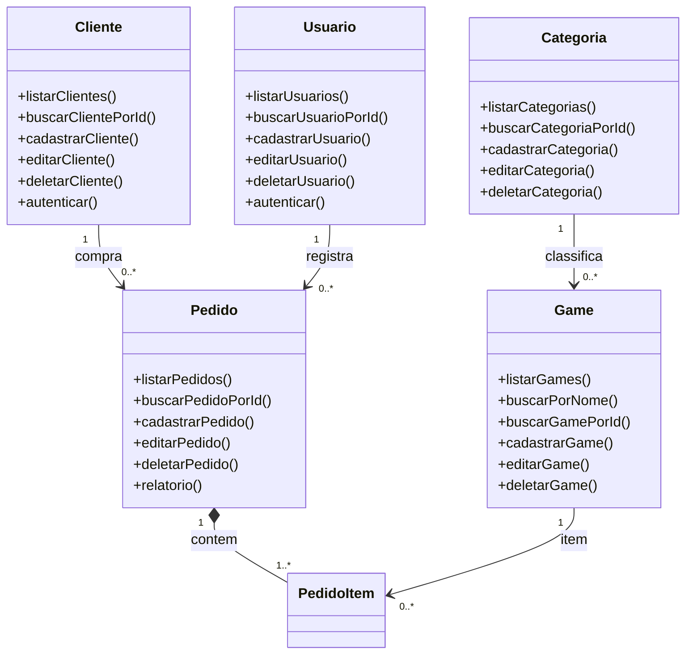
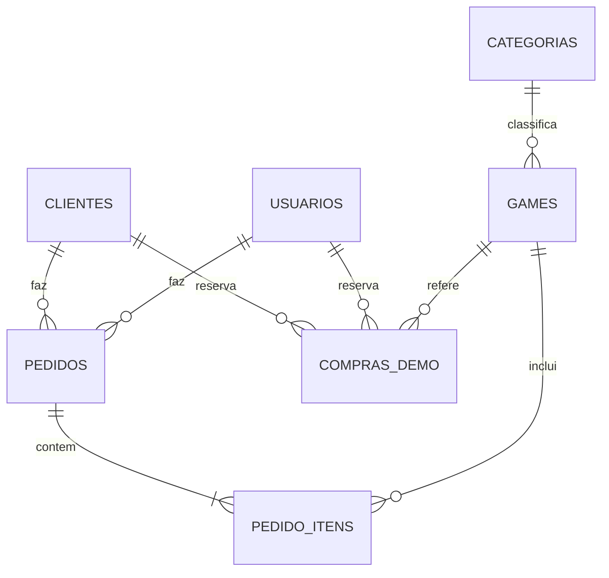

# GameStock

Loja de jogos em PHP, com catálogo público, cadastro de clientes e área administrativa.

## Integrantes

- Luiz Fernando Mendes Nobre

## Tema da loja

Loja de jogos. O catálogo vende jogos digitais de demonstração: aventura, ação, RPG, sandbox e outros estilos cadastrados no banco.

## Descrição do sistema

A GameStock apresenta a loja em uma página pública, lista os jogos cadastrados e permite busca por nome. O visitante cria uma conta de cliente com nome, e-mail, telefone e senha. Depois do login, pode ver o detalhe de um jogo e registrar uma compra de demonstração. Essa compra não cobra nada: ela grava um pedido e baixa uma unidade do estoque.

A área administrativa exige um usuário do tipo administrador. Nela ficam o painel, o relatório de vendas e o CRUD de usuários, clientes, jogos, categorias e pedidos.

## Regras de negócio

- O cadastro público cria somente cliente. Não cria administrador.
- Administrador e cliente entram pelo mesmo formulário. A gestão da loja aceita apenas administrador.
- Senha nova é gravada com `password_hash()`.
- O mesmo e-mail não pode existir ao mesmo tempo em usuário e cliente.
- Cada jogo pertence a uma categoria. O filtro do catálogo usa essa categoria.
- O preço do pedido é o preço do jogo no banco, não um valor digitado no formulário.
- Compra no catálogo exige login, permite uma unidade por conta e por jogo, e baixa o estoque na mesma transação.
- Cancelar ou excluir um pedido ativo devolve as unidades ao estoque.
- Não é possível excluir uma categoria usada por um jogo, nem um jogo que já esteja em um pedido.
- Excluir um cliente ou usuário não devolve estoque. O pedido permanece para o relatório.

## Tecnologias utilizadas

- PHP 8.2
- MySQL / MariaDB
- PDO
- HTML, CSS e JavaScript
- Programação orientada a objetos
- Arquitetura MVC: `admin/models`, `admin/views` e `admin/controllers`
- Sessão para autenticação
- XAMPP

## Diagrama de classes

`PedidoItem` é a tabela `pedido_itens`. Ela não tem tela própria: entra e sai junto com o pedido. A classe `CompraDemo` continua responsável pela compra feita direto no catálogo e grava o mesmo pedido.

## Modelo do banco de dados

Tabelas: `usuarios`, `clientes`, `categorias`, `games`, `pedidos`, `pedido_itens` e `compras_demo`.

As chaves estrangeiras estão no script `database/etapa_academica.sql`. `games.categoria_id` aponta para `categorias`. O pedido aponta para um cliente ou para um usuário. O item aponta para o pedido e para o jogo.

## Como instalar e executar

1. Instale o XAMPP com Apache e MySQL.
2. Copie esta pasta para `C:\xampp\htdocs\loja_games`.
3. Abra o painel do XAMPP e inicie Apache e MySQL.
4. No phpMyAdmin, importe o script certo:
   - instalação nova: `database/instalar_completo.sql`;
   - banco `loja_games` que já existia: `database/etapa_academica.sql`.
5. Abra [http://localhost/loja_games/](http://localhost/loja_games/).

Se o Apache estiver na porta 8080, use `http://localhost:8080/loja_games/`. Não importe `instalar_completo.sql` por cima de um banco que já tem dados: esse arquivo recria as tabelas iniciais.

Nesta máquina o script da etapa acadêmica já foi aplicado. Os jogos, as contas e as compras que já existiam foram mantidos.

## Usuário e senha de teste

| Acesso | E-mail | Senha |
| --- | --- | --- |
| Administrador | `admin@gamestock.local` | `Admin@123` |
| Cliente | `cliente@gamestock.local` | `Cliente@123` |

A conta de administrador já usada no projeto continua no banco, com a senha definida antes. As senhas ficam apenas como `password_hash`.

## Funcionalidades implementadas

Cinco classes com CRUD:

- Usuário
- Cliente
- Game, o produto da loja
- Categoria
- Pedido

Também entram:

- página inicial pública com os jogos do banco
- cadastro de cliente pela própria loja
- login, logout e sessão
- proteção da área administrativa
- busca de jogos por nome
- filtro por categoria
- upload de capa
- controle de estoque
- página de detalhes do jogo
- compra de demonstração
- painel administrativo
- relatório de vendas
- validação do formulário de cliente com JavaScript

## Prints das principais telas

Os arquivos estão na raiz do projeto.

O cadastro público agora também pede telefone. O painel, as categorias, os clientes e os pedidos ficam no menu **Gestão da loja**, visível só para o administrador.

## Repositório no GitHub

O projeto ainda não está em um repositório Git. Para a entrega, crie um repositório público, envie esta pasta e troque o endereço abaixo pelo link real.

https://github.com/SEU-USUARIO/loja_games
